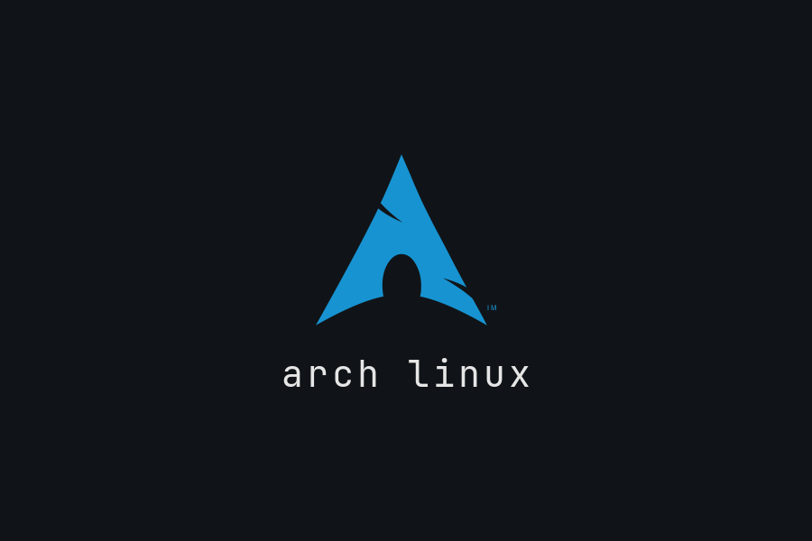

# Arch Linux — ASUS Vivobook S14 (S3407CA)

Instalação de **Arch Linux puro** com kernel compilado para este processador e
Hyprland com a identidade visual do Arch (azul `#1793D1`, wallpaper e logo oficiais).

O passo a passo está em **[GUIA.md](GUIA.md)**.

## Hardware (levantado em 2026-11-06)

| Componente | Peça | Driver Linux |
|---|---|---|
| CPU | Intel Core Ultra 5 225H (Arrow Lake-H, 4P+8E+2LPE, sem AVX-512) | `intel_pstate`, ITMT/HFI |
| GPU | Intel Arc integrada `8086:7DD1` | `i915`, Mesa, `intel-media-driver` |
| NPU | Intel AI Boost `8086:7D1D` | `intel_vpu` |
| RAM | 16 GB DDR5-5600 **soldada** (canal A) + **1 slot SO-DIMM livre** (canal B) | — |
| SSD | Samsung NVMe 1 TB (único slot M.2 2280, só face simples) | `nvme` (VMD desligado) |
| Wi-Fi / BT | Realtek RTL8852BE / `13D3:3571` | `rtw89_pci` / `btusb` |
| Áudio | Intel SOF + Realtek ALC256 + microfones digitais | `sof-firmware`, `alsa-ucm-conf` |
| Touchpad | ASUS ASCE1205 (I2C HID) | `i2c_hid_acpi` |
| Câmera | FHD + IR `3277:0018` | `uvcvideo` |
| Bateria | 70 Wh | `asus-nb-wmi` (limite de carga) |

**Upgrade recomendado:** 1× 16 GB DDR5-5600 SO-DIMM (1Rx8) → 32 GB em dual channel
(ex.: Samsung M425R2GA3PB0-CWM, Crucial CT16G56C46S5, Kingston KVR56S46BS8-16).

## Decisões

- **Disco:** Arch sozinho, ESP de 1 GiB em `/efi`, resto em LUKS2.
- **Criptografia:** LUKS2 com desbloqueio por TPM2 (PCR 7) + Secure Boot com chaves próprias (`sbctl`).
- **Sistema de arquivos:** Btrfs (`@`, `@home`, `@snapshots`, `@var_log`, `@var_cache`, `@var_tmp`), zstd:1, snapper + snap-pac.
- **Boot:** systemd-boot + UKIs (kernel+initramfs+cmdline num só `.efi`, assinado) e Plymouth
  com o logo do Arch sobre grafite — a senha do disco é pedida na tela gráfica.


- **Kernel:** `linux-cachyos` compilado localmente com `-march=native`, Clang ThinLTO, 1000 Hz; `linux-lts` oficial como reserva.
- **Desktop:** Hyprland + Waybar + Wofi + Mako + Kitty + hyprlock/hypridle, login com greetd/tuigreet.
- **Energia:** power-profiles-daemon, thermald, zram, bateria limitada a 80%.
- **Instalação:** assistente automático no tty1, archinstall oficial ou Calamares (gráfico);
  os três usam o mesmo layout de disco, LUKS2, Btrfs, UKI, Secure Boot/TPM e Hyprland.

## Estrutura

```
iso/build.sh                     Gera ISO personalizada com instalador automático e gráfico
                                 (Calamares compilado do AUR; rodar no Arch x86_64)
iso/calamares/                   Configuração e identidade visual do Calamares
iso/xinitrc                      Sessão X (openbox) que abre o Calamares no tty1
scripts/auto.sh                  Assistente do boot: teclado, Wi-Fi, scripts atualizados e menu
                                 (automático, gráfico ou archinstall)
scripts/install.sh               Instalação completa: perguntas no início, depois base + Wi-Fi +
                                 pós-instalação + kernel + Secure Boot, sem intervenção
scripts/gui.sh                   Instalação gráfica: Calamares + etapas extras no terminal
scripts/calamares-pacstrap.sh    Instala a base do sistema depois do particionamento do Calamares
scripts/calamares-target.sh      fstab, UKI, systemd-boot e serviços do sistema instalado
scripts/archinstall-run.sh       Alternativa: archinstall oficial com nossa config pré-carregada,
                                 seguido das mesmas etapas extras
scripts/archinstall-config.py    Gera a config do archinstall 4.x para o disco real
scripts/lib/                     Funções, pacotes e etapas compartilhadas pelos instaladores
scripts/setup-system.sh          Pós-instalação, parte root (pacotes, serviços, snapper, bateria)
scripts/setup-user.sh            Pós-instalação, parte usuário (paru, configs Hyprland/visual Arch)
scripts/post-install.sh          Roda as duas partes acima manualmente, se a etapa foi pulada
scripts/build-kernel.sh          Compila o kernel otimizado
scripts/plymouth-theme.sh        Tela de boot Plymouth com identidade Arch
scripts/firstboot-secureboot.sh  Serviço de boot: registra chaves do Secure Boot e o TPM2
test/vm.sh                       Testa a ISO numa VM QEMU (UEFI + Secure Boot + TPM2 + NVMe)
scripts/secureboot-tpm.sh        Secure Boot + TPM2 manual
config/                     Hyprland, Waybar, Mako, Kitty, ajuste opcional do Wi-Fi
```
